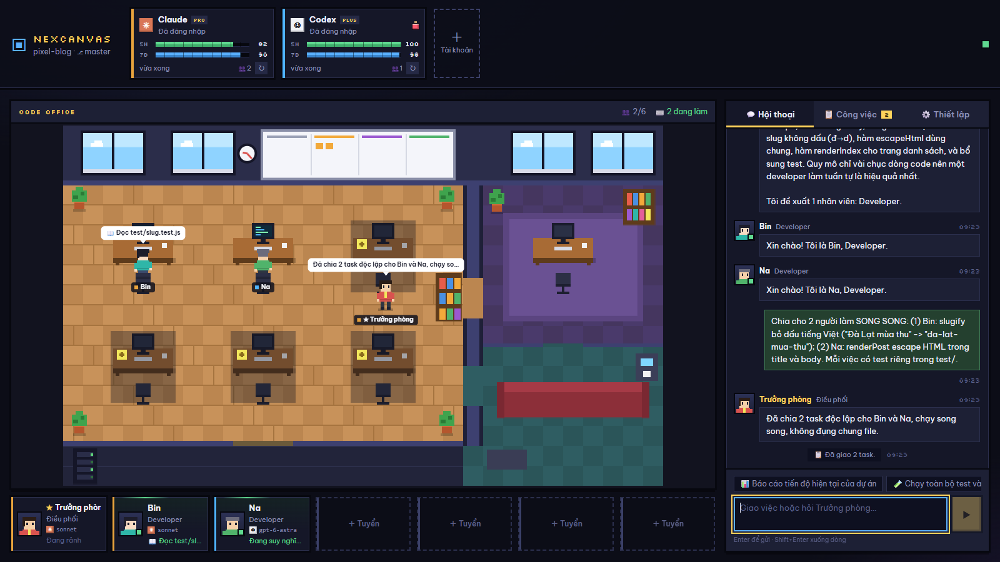
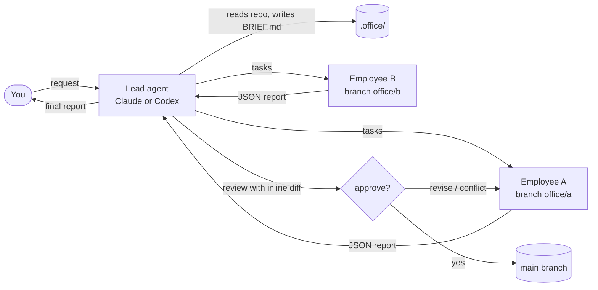
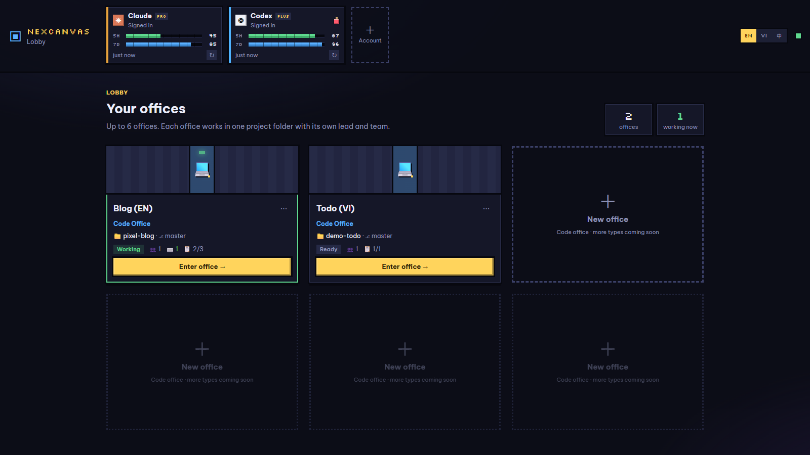

<div align="center">

# NexCanvas Agent Manager

### A local pixel-art office where a lead agent hires, delegates to, and reviews a team of Claude Code and Codex agents

[](LICENSE)
[](https://nodejs.org/)
[](https://docs.claude.com/claude-code)
[](https://github.com/openai/codex)
[](https://github.com/sunniie/nexcanvas-agent-manager/actions/workflows/ci.yml)

You are the boss. Pick a **lead agent**, point it at a project, and it proposes the
smallest team that can do the job, gives every employee its own git branch and its own
long-lived session, reviews their diffs, merges approved work, and reports back.
When an account runs out of quota, the employee takes a nap and resumes the same task
the moment the window resets. Run up to six offices side by side, in English,
Vietnamese or Chinese.

</div>



## Why it exists

Most multi-agent managers hard-code a fixed crew, spawn a fresh agent for every request,
and burn tokens re-explaining the project. NexCanvas Agent Manager is built around four
different assumptions:

- **Team size should follow the project.** The lead reads the repository and proposes 1–6
  people, each with a reason. A 20-line script gets one developer, not a department.
- **Employees should remember.** Each one resumes its own CLI session (`--resume`) and keeps a
  short handover notebook, so context survives across tasks, restarts, and account switches.
- **Quota is a scheduling problem, not a failure.** A usage limit parks the job until the reset
  time (or moves it to another account, if you allow it). The task always finishes.
- **The manager must cost almost nothing on top of the work.** Prompts are designed for cache
  hits; measured resumed turns hit the prompt cache **92–99%** of the time.



## Showcase



The lobby holds up to six offices. Each one works in its own project folder with its own lead and team, and keeps working in the background while you are in another office. The green light marks an office that is working right now.

> The interface is available in English, Vietnamese and Chinese. Screenshots come from a real run on a small demo project, recorded with `NEXCANVAS_PRIVACY=1`, which hides account names and e-mails.

## What it does

| Capability | Behavior |
|---|---|
| Lobby with up to 6 offices | Each office is bound to one project folder and has its own lead, team, task board, permissions and scheduler. Offices keep working in the background while you set up or browse another one |
| Office types | **Code** is available today. **Short-video studio** and **Other** (a flexible office with explicit limits) are designed and shown in the lobby behind a lock until they ship |
| Three languages | Pick English, Vietnamese or Chinese on first launch (switchable any time). Each office locks its agent language when the lead is appointed, so agents write briefs, tasks and reports in that language |
| Understand first, hire second | No employee is created until the lead has surveyed the project, written `BRIEF.md` and proposed a team |
| Flexible staffing | The lead reads the repo plus optional context documents and proposes 1–6 roles (developer, frontend, backend, UI/UX, tester, reviewer, DevOps, docs), each with a model tier and a reason. You can push back in plain words ("only two people") |
| Real agents | Every employee is a real `claude -p` or `codex exec` process with structured JSON output. Nothing is simulated |
| Persistent memory | One resumed session per employee, plus a handover notebook in `.office/agents/<id>.md`. Over-grown sessions rotate into a fresh one that reads the notebook |
| Multiple accounts | Each account lives in its own config directory (`CLAUDE_CONFIG_DIR` / `CODEX_HOME`), so two Claude or two Codex accounts can run side by side. Several employees can also share one account |
| Quota HUD | 5-hour (HP) and weekly (MP) bars per account. Codex is read live from `codex app-server` at zero token cost. Claude is updated from `rate_limit_event` on every run |
| Reset potions | Free Codex "full reset" credits appear as potions on the account card |
| Auto-resume | A usage limit parks the job until the reset time, then resumes the **same session** with a "continue where you stopped" note. This survives app restarts |
| Failover (optional) | Instead of waiting, move the employee to another account with headroom: same provider only, or any provider at the same model tier |
| Git worktrees | With two or more people in a git repo, each employee works in its own worktree on an `office/*` branch. Approved work is committed and merged into your current branch; conflicts go back to the right person with the file list |
| Review | The lead gets the employee's diff inline (no extra tool calls), may run the test suite, and approves or requests a revision |
| Grant once | Pushing, deploying, installing dependencies, or network access is requested once per project and then reused. Grants can be revoked at any time |
| Image attachments | Paste a screenshot with Ctrl+V, drop image files, or attach them with 📎 (up to 6 per message). The lead sees them directly, and every task created from that message carries the same images to the employee who does it. Images are saved in `.office/attachments/` and downscaled in the browser to the size models actually use |
| Report board | Every finished task is pinned to a board with its evidence screenshots and a one-line result, grouped by request. Employees capture the screenshots themselves with the bundled `tools/shot.mjs` (headless Edge/Chrome, can start and stop a dev server), the lead looks at them while reviewing, and you can add or remove images by hand. Export the board as one self-contained HTML file to share |
| Context import | Finds your previous Claude Code and Codex sessions for the folder, including sessions started in a subfolder or in a parent folder that actually worked on this one (e.g. a chat opened in `~/work` that edited `~/work/app`), and condenses them locally (no model calls, streamed so even 400 MB transcripts take about a second). Sessions run by the office's own agents are left out. You can also upload `.txt`/`.md` files or copy a handover prompt into an old chat |
| Skills | Scans `SKILL.md` frontmatter from Claude and Codex (never the bodies). The lead assigns at most four relevant skills per role |
| Folder picker | The native Explorer-style "Select folder" dialog (brought to the front even when the server runs hidden), plus an in-app folder browser that works everywhere |
| Pixel office | A procedurally drawn office (no third-party art): the window sky follows the clock, the whiteboard is a live kanban, and employees type, walk, and sleep |

## Quick start

Requirements: Node.js ≥ 20 and at least one logged-in CLI:
[Claude Code](https://docs.claude.com/claude-code) (`claude`) or [Codex CLI](https://github.com/openai/codex) (`codex`).

```bash
git clone https://github.com/sunniie/nexcanvas-agent-manager.git
cd nexcanvas-agent-manager
npm install
npm start            # builds the UI and opens http://127.0.0.1:4317
```

For development, `npm run dev` runs the server in watch mode plus Vite on `http://127.0.0.1:5317`.

On first launch, choose a language. In the **lobby**, create an office (Code for now) and enter it, then follow the five setup steps:

1. **Lead agent**: Claude Code or Codex, plus account and model.
2. **Project folder**: any local directory. A git repository enables parallel branches.
3. **Context**: optional. Import old sessions, upload notes, or skip.
4. **Team proposal**: accept it, or describe what you want instead.
5. **Staffing**: an account, model, effort, and skills for each employee.

Then give the lead work in the chat.

## Token-saving design

| Technique | Effect |
|---|---|
| One fixed JSON schema for every lead turn | The schema is a tool definition at the start of the cache prefix. Switching schemas per turn invalidated the whole cache; one schema keeps it warm |
| `--exclude-dynamic-system-prompt-sections` | `git status` and cwd stay out of the system prompt, so edits by employees don't break the lead's cache |
| Lean sessions | No MCP servers in agent sessions (about 20% less context per session) |
| Files instead of chatter | `BRIEF.md` is written once for the whole office. Tasks, reports, and notebooks are small files |
| Inline review diff | The reviewer doesn't spend turns re-reading files it was just told about |
| Local condensing of old chats | Tool calls and results are dropped before the lead ever reads a past session (often 90%+ smaller) |
| Small teams by default | Trivial work is never split across several people |

The server logs every turn as `new / cached / output` tokens, so the overhead can be measured.

## How it works

```
server/
  index.ts          HTTP + WebSocket on 127.0.0.1, Host/Origin checks
  office.ts         office state, job queue, scheduler, quota parking, failover, merge flow
  accounts.ts       account detection, live quota, per-account config dirs, login launcher
  runner/claude.ts  claude -p --output-format stream-json --resume …
  runner/codex.ts   codex exec --json / codex exec resume …
  git.ts            worktrees, branch sync, merge, conflict hand-back
  context.ts        finding and condensing previous sessions
  skills.ts         SKILL.md frontmatter scan
  prompts.ts        role cards, the lead schema, per-job prompts (English, with an output-language rule)
  i18n.ts           server messages in en / vi / zh
tools/shot.mjs        evidence screenshots for employees (headless Edge/Chrome, optional --serve)
templates/*.json      office types: roles, workflow, guidance, localized descriptions
                      (code = available; video, other = locked)
web/src/locales/      UI translations (vi, zh; English strings are the keys)
web/src/office/       procedural pixel renderer
shared/types.ts       types shared by server and UI
```

Inside your project the app keeps a `.office/` folder. It adds the folder to
`.git/info/exclude`, so it never shows up in your commits:

```
.office/
  BRIEF.md         project brief shared by the whole office
  context/         imported context documents
  agents/<id>.md   each employee's handover notebook
  reports/         task reports and final reports
```

App data lives in `~/.nexcanvas/`: the office registry and language (`config.json`), each
office's state (`offices/<id>/state.json`, restored on restart), extra account profiles, and
employee worktrees (`worktrees/`), which sit outside your projects so your tooling never
indexes them.

## Configuration

| Variable | Purpose |
|---|---|
| `NEXCANVAS_PORT` | Server port (default `4317`) |
| `NEXCANVAS_PRIVACY=1` | Screen-sharing mode: hides account names and e-mails in the UI |
| `NEXCANVAS_SIMULATE_LIMIT=30` | Dev aid: fake one usage-limit hit (resets in 30 s) to exercise sleep → resume |
| `NEXCANVAS_RESUME_BUFFER_MS` | Extra wait after a reset before resuming (default `90000`) |

## Security

Agents can edit files and run commands. The server listens on `127.0.0.1` only and rejects
requests whose `Host` or `Origin` is not the app itself, so other pages open in your browser
cannot drive it. Without grants, workers run with edit permission plus a whitelist of build and
test commands, and the lead runs read-only with test commands. `full_access` removes the sandbox;
enable it only for projects you trust.

## Roadmap

- [x] Flexible staffing, persistent sessions, auto-resume on quota
- [x] Git worktree per employee, auto-merge, conflict hand-back
- [x] Optional account failover, live Codex quota, reset potions
- [x] Lobby with up to 6 offices running in parallel
- [x] English, Vietnamese and Chinese
- [ ] Unlock the Short-video studio and Other offices (designed, locked for now)
- [ ] Desktop packaging (Tauri)
- [ ] Per-task cost budget and stop conditions

## License

[MIT](LICENSE) © Le Quang Vinh
